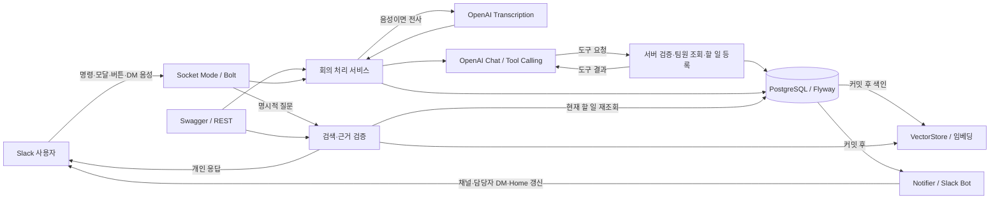

# MeetoDo

회의록 텍스트·녹음에서 할 일·담당자·마감일을 추출하고, Slack에서 배정·확인·완료하는 셀프 호스팅 AI 에이전트 서비스입니다. **판단은 모델, 검증·계산은 서버, 확정은 사람**을 기준으로 설계했습니다.

한 설치가 한 Slack 워크스페이스를 사용합니다. 각 팀이 자기 서버·Slack 앱·OpenAI API 키를 관리합니다. 멀티 테넌트 SaaS는 구현하지 않았습니다.

개인 프로젝트 · 2026.11.10~ · Java 21 / Spring Boot 3.5.16 / Spring AI 1.1.8 / OpenAI / PostgreSQL / Flyway / Slack Bolt for Java 1.54.0. 구현에 Codex를 활용했고, 설계·정책 결정, 실제 문제 발견·원인 분석, Slack 실행 검증과 실측은 개발자가 수행했습니다.

## 할 수 있는 일

- `/meetodo` 모달에 회의록 입력, 봇 DM에 음성 파일 업로드, 채널에서 `@MeetoDo`와 함께 음성 업로드. DM 입력의 결과는 지정 팀 채널에 게시하고 DM에는 링크를 남깁니다.
- 모델이 `findMember`, `findTasks`, `createTask`를 선택하고 서버가 실행합니다. 도구 호출 순서·인자·결과·오류·시간을 마스킹 후 기록합니다.
- 동명이인·팀 불일치·미등록 담당자는 추측하지 않고 미정 사유와 후보를 표시합니다. 사람이 Slack에서 확정할 수 있습니다.
- 같은 본문 재전송은 기존 회의 반환, 같은 담당자·정규화 제목·TODO는 기존 할 일 재사용. 관련 기록을 지우지 않고 같은 할 일 묶음 회의는 `duplicateOfMeetingId`로 표시합니다.
- 완료·수정·담당자 변경 후 관련 채널·DM·앱 Home을 DB 기준으로 다시 그립니다. 새 배정은 담당자별 DM으로 묶어 보냅니다.
- 앱 Home에서 내 할 일과 미정 할 일을 확인하고, 팀원은 본인 등록을 신청해 관리자 승인을 받습니다.
- 평일 오전 9시(Asia/Seoul) 마감 지남·오늘·3일 이내 업무를 알립니다. 날짜·상태 규칙으로 처리하며 LLM을 사용하지 않습니다.
- `/meetodo 질문 …`으로 승인된 팀원이 회의 기록을 검색하고, 검증한 출처와 현재 할 일 상태를 확인합니다(선택 활성화, 초기10문항 평가·거절 진단 진행 중).
- 회의별 모델 사용량과 설정 단가에 따른 예상 비용을 조회합니다. 실제 청구액과 일치한다고 보장하지 않습니다.

## 구조



모델은 도구와 인자를 제안하며 실제 도구 실행 주체는 서버입니다. Spring AI `ToolCallingManager` 루프를 직접 제어하고 회의당 도구 호출을 20회로 제한합니다. 상대 날짜는 주입한 `Clock`과 서버 규칙으로 계산합니다. 후보 목록은 참고 정보이며, 한 명으로 확정된 조회만 배정 근거로 인정합니다.

알림은 확정된 결과를 전달하는 서버 작업으로 두었습니다. DB 커밋 후 전송하며 알림·DM 실패가 회의 DONE을 되돌리지 않습니다. 타임아웃 시 이미 도착했을 수 있어 자동 재시도하지 않습니다. 중복보다 누락을 택하고 FAILED로 기록합니다. 정확히 한 번 전달은 보장하지 않으며 향후 Outbox 패턴을 검토할 수 있습니다. `Notifier` 구현체를 추가하면 두레이 같은 사내 메신저도 연결할 수 있습니다(두레이 구현 없음).

## 설치 요구사항

- Docker Engine 또는 Docker Desktop 및 Docker Compose v2(`--wait` 지원)
- 앱 생성·설치가 가능한 Slack 워크스페이스 권한
- 유효한 OpenAI API 키와 사용 가능한 채팅·음성 모델
- 서버에서 Slack·OpenAI로 나가는 네트워크 연결

Socket Mode는 공개 콜백 URL이나 인바운드 Slack 포트가 필요 없습니다. 앱이 실행 중이어야 Slack 입력·버튼이 동작합니다. Docker의 REST/Swagger 포트는 기본적으로 `127.0.0.1`에만 바인딩합니다. 현재 REST 인증은 없으므로 공개 노출하지 마세요.

### 1. Slack 앱 만들기

1. [Slack 앱 관리](https://api.slack.com/apps)에서 **Create New App → From a manifest**를 선택하고 워크스페이스를 고릅니다.
2. 저장소의 [slack-app-manifest.yml](slack-app-manifest.yml)을 붙여 넣어 앱을 만듭니다.
3. **Basic Information → App-Level Tokens**에서 `connections:write`로 앱 레벨 토큰을 발급합니다.
4. **Install App → Install to Workspace** 후 OAuth & Permissions의 봇 토큰을 보관합니다. 권한 변경 시 재설치합니다.
5. **Socket Mode / Interactivity / App Home / Event Subscriptions / Slash Commands**가 아래 매니페스트 값과 같은지 확인합니다.

| 설정 | 값 / 용도 |
|---|---|
| Socket Mode | 켜짐, 앱 레벨 토큰은 별도 발급 |
| Interactivity | 켜짐, 버튼·모달 |
| App Home | Home Tab + Messages Tab, 사용자 메시지 허용 |
| 명령 | `/meetodo` |
| 이벤트 | `app_home_opened`, `message.im`, `app_mention` |
| `chat:write` | 메시지 게시·수정·삭제·사용자 안내 |
| `commands` | 슬래시 커맨드 |
| `im:write` | 담당자·신청·승인 DM 열기 |
| `files:read` | 접근 가능한 첨부 음성 다운로드 |
| `im:history` | 봇 DM 메시지 이벤트 |
| `app_mentions:read` | 채널 멘션 이벤트 |

봇 모드는 Web API를 사용하므로 `incoming-webhook` 권한이 필요 없습니다. 기존 Slack 웹훅·Discord 모드는 별도 옵션으로 유지합니다. 사용자 선택 메뉴의 Slack ID를 사용하므로 `users:read`를 추가하지 않습니다. 공개 채널 자동 게시 권한 `chat:write.public`도 요구하지 않습니다. 봇을 직접 초대합니다.

공식 근거: [매니페스트](https://docs.slack.dev/reference/app-manifest/), [Socket Mode](https://docs.slack.dev/apis/events-api/using-socket-mode/), [App Home](https://docs.slack.dev/surfaces/app-home/), [파일 접근](https://docs.slack.dev/reference/objects/file-object/). 매니페스트와 등록 이벤트·사용 Web API의 권한 대응은 계약 테스트로 확인합니다.

### 2. 팀 채널과 관리자 정하기

팀 결과를 받을 채널을 만들고 `/invite @MeetoDo`로 봇을 초대합니다. 채널 상세 화면에서 채널 ID, 관리자 프로필의 메뉴에서 멤버 ID를 복사합니다. 관리자 여러 명은 쉼표로 구분합니다. Slack ID와 별개로 성·이름은 직접 등록하며 표시 이름에서 추측하지 않습니다.

### 3. 환경 설정 후 실행

```sh
git clone https://github.com/chaan32/MeetoDo.git
cd MeetoDo
cp .env.example .env
```

`.env`에 최소한 아래 항목을 채웁니다. 비밀값은 이 문서나 저장소에 넣지 않습니다. `.env`는 Git에서 제외되어 있습니다.

```dotenv
SPRING_PROFILES_ACTIVE=docker,openai
NOTIFIER_TYPE=slack-bot
MEETODO_SLACK_BOT_ENABLED=true
MEETODO_SLACK_DM_ENABLED=true
OPENAI_API_KEY=
SLACK_APP_TOKEN=
SLACK_BOT_TOKEN=
SLACK_CHANNEL_ID=
MEETODO_ADMIN_SLACK_IDS=
POSTGRES_PASSWORD=
```

빈 항목에는 본인 값을 넣습니다. 채팅 기본값은 `gpt-4o-mini`, 음성 기본값은 `gpt-transcribe`이며 계정에서 사용 가능한 모델로 `OPENAI_CHAT_MODEL`·`MEETODO_STT_MODEL`을 바꿀 수 있습니다. 가격 기본값은 없습니다. 나머지 선택 항목·기본값은 [.env.example](.env.example)에 설명되어 있습니다.

```sh
docker compose up -d --build --wait
docker compose ps
docker compose logs -f app
```

첫 빌드는 Gradle 의존성 다운로드와 이미지 생성으로 시간이 걸릴 수 있습니다. `http://localhost:8080/actuator/health`와 `http://localhost:8080/swagger-ui/index.html`로 확인합니다. 명시적 `slack-bot` 모드의 토큰·채널 ID, `openai` 프로필의 API 키가 빠지면 누락 변수 이름만 알리고 시작을 중단합니다.

### 4. 첫 관리자와 팀원 등록

Docker에는 샘플 팀원이 없습니다. `MEETODO_ADMIN_SLACK_IDS`에 있는 관리자는 팀원이 아니어도 앱 Home의 **👥 팀원 관리**를 열 수 있습니다. 먼저 본인의 성·이름·팀·Slack 사용자를 등록합니다.

다른 사용자는 앱 Home의 **내 정보 등록**에서 신청합니다. 성·이름·기존 팀 또는 새 팀을 입력하며 Slack 사용자는 본인으로 고정됩니다. 관리자는 DM에서 **승인 / 수정 후 승인 / 거절**합니다. 처리 후 다른 관리자의 요청 DM도 갱신됩니다. 승인 전 신청자는 담당자 후보에 들어가지 않습니다. 같은 이름은 경고하되 승인할 수 있습니다. 거절 후 재신청할 수 있습니다.

두 번째 계정으로 `신청 → 승인 → 새 업무 배정 → 담당자 DM → 본인 완료`까지 확인하면 설치와 권한 흐름을 점검할 수 있습니다. 비활성 팀원은 후보에서 제외하되 기존 기록은 보존합니다.

### 5. 사용하기

- `/meetodo` → 회의록 입력 모달 → 처리 중 메시지 → 결과로 수정.
- 봇 DM에 지원 음성 파일 업로드 → DM 진행 안내 → 팀 채널 결과 링크. 담당자 새 배정 DM의 링크도 팀 채널을 가리킵니다.
- 채널에서 `@MeetoDo` 멘션과 함께 음성 첨부 → 그 채널의 원래 메시지 스레드에 결과. 멘션 없는 채널 파일은 무시합니다.
- 할 일의 **✅ 완료**, 개인 관리 메뉴, 담당자 지정 수단과 앱 Home을 사용합니다.

예시(이름과 팀은 등록한 팀원에 맞게 변경):

```text
백엔드팀 이지영은 로그인 API 오류를 다음 주 금요일까지 수정한다.
전해찬은 배포 로그를 내일까지 정리한다.
담당자가 정해지지 않은 회의실 예약도 확인한다.
```

Swagger `POST /api/meetings`에서는 다음 본문으로 같은 서비스를 호출합니다.

```json
{"rawText":"백엔드팀 이지영은 로그인 API 오류를 다음 주 금요일까지 수정한다."}
```

`GET /api/meetings/{id}`의 tasks·경고·호출 횟수·usage, `GET /api/meetings/{id}/logs`의 도구 순서를 확인합니다. 원문 전체를 공개 캡처하지 마세요. 같은 본문 재전송은 새로 처리하지 않습니다. 봇 미초대 게시 실패는 회의를 저장하지 않으므로 초대 후 다시 시도할 수 있습니다.

음성은 파일당 25MB 이하의 `flac/mp3/mp4/mpeg/mpga/m4a/ogg/wav/webm`을 받습니다. 형식만 맞는 손상 파일은 전사에 실패할 수 있습니다. 긴 파일 분할과 화자 구분은 지원하지 않습니다. “제가 할게요”만으로는 담당자를 추측하지 않으며, 미정 업무를 사람이 지정합니다. 파일 ID는 한 번만 선점하지만 새 ID로 재업로드한 같은 바이트까지 구분하지는 못합니다.

## 권한과 업무 규칙

| 작업 | 허용 대상 |
|---|---|
| 배정된 업무 완료 | 담당자 본인만, 관리자 예외 없음 |
| 미정 업무 완료·담당자 지정 | 누구나 |
| 이미 배정된 업무의 담당자 변경 | 관리자만, TODO에 한함 |
| 제목·마감일 수정 / 삭제 / 완료 취소 | 담당자 본인 또는 관리자, 미정은 누구나 |
| 팀원 등록·수정·비활성화 / 신청 승인·거절 | 관리자 |

공유 메시지에서는 개인 관리 모달로 들어간 뒤 실제 사용자 권한으로 처리합니다. 날짜·제목·중복·권한 검증은 REST와 Slack의 공통 서비스에서 수행합니다. REST의 `X-Slack-User-Id`는 로컬 데모용 호출자 표시로 실제 인증을 대체하지 않습니다.

- 제목은 짧은 명사형 업무 이름입니다. 문장형은 `INVALID_TITLE_FORMAT`으로 거절합니다. 직접 API는 400으로 안내합니다.
- 같은 담당자(미정 포함) + 정규화 제목 + TODO면 재사용합니다. 직접 등록 API는 409와 기존 ID를 반환합니다. DONE은 새 업무로 생성할 수 있습니다.
- 같은 업무 묶음의 새 회의도 기록·로그는 보존합니다. `duplicateOfMeetingId`가 있는 회의는 언급 횟수를 늘리지 않습니다. 직접 만든 업무의 언급 횟수는 0입니다.
- “이번 주/다음 주”는 월~일, “이번 주 안에”는 일요일입니다. `내일/모레`, ISO·짧은 날짜를 서버가 해석하며 원문에 없는 날짜는 거절합니다. `까지/까지는`은 정리하지만 의미가 다른 `전까지`는 지원하지 않습니다.
- 확정할 수 없는 담당자·날짜는 경고와 함께 비워 둡니다. 과거 날짜는 첫 시도 거절 후에도 과거면 마감일 없이 등록합니다.

## 회의 기록 질문(RAG, 선택 기능)

승인된 활성 팀원은 `/meetodo 질문 결제 API 스펙 담당자와 현재 상태는?`으로 질문합니다. 답은 질문한 사람에게만 보입니다. 일반 `/meetodo` 모달·멘션·음성 입력은 회의 처리 경로로 유지하며 질문 경로는 할 일을 만들지 않습니다. 기존 Slack 권한·이벤트로 동작하므로 이 기능 때문에 앱 재설치는 필요하지 않습니다.

```text
DONE 회의 커밋 → 별도 작업 큐 → 회의별 청크·연결된 할 일 → 임베딩 → VectorStore
질문 → 활성 팀원 확인 → 임베딩·상위 5개 검색 → 임계값 검사
     → 답변 모델 → 문서 ID·회의 ID·인용 검증 → 당시 기록 + DB의 현재 할 일 상태
```

색인 대상은 **MeetoDo가 처리한 DONE 회의와 연결된 할 일**입니다. Slack 전체 대화나 회의 없이 직접 등록한 할 일은 포함하지 않습니다. 팀 전체 공유 범위이며 채널별 접근 제어는 없습니다. 모델이 선택한 출처가 실제 검색 결과 안에 있는지, 인용문이 공백·줄바꿈만 정규화한 원문에 포함되는지 서버가 확인합니다. 퍼지 매칭과 출처 없는 자유 서술은 답에 쓰지 않습니다. 회의록 인용은 당시 기록으로, 담당자·마감일·상태는 답변 시점 DB에서 읽은 현재 상태로 분리합니다. 할 일 색인 텍스트의 오래된 상태는 공개 인용문으로 쓰지 않습니다.

회의를 섞지 않고 목표 300토큰으로 나눕니다. 유사도 기본값 **0.75는 측정 전 임시값**이며 정확도를 보장하는 기준이 아닙니다. 임계값을 넘는 결과가 없으면 답변 LLM을 부르지 않고 `기록에 없습니다`를 반환합니다(질문 임베딩 호출은 발생할 수 있음). 색인이 준비되지 않았으면 `INDEX_NOT_READY`, 근거 검증에 실패하면 `UNVERIFIED`로 구분합니다. 출처는 등록일과 회의 ID를 표시하며 ‘지난주’ 같은 날짜 해석·검색 필터는 이번 범위에 없습니다.

### 설정과 실행

`.env.example`에 다음 선택 설정이 있습니다. 기본은 RAG 비활성입니다.

```dotenv
MEETODO_RAG_ENABLED=true
MEETODO_EMBEDDING_MODEL=text-embedding-3-small
MEETODO_RAG_CHUNK_TOKENS=300
MEETODO_RAG_SIMILARITY_THRESHOLD=0.75
# Docker에서 관리자 재색인 API를 사용할 때만 활성화
MEETODO_DEV_ENDPOINTS_ENABLED=true
```

local/H2에서는 Spring AI 메모리 VectorStore를 사용하고 시작할 때 DB에서 다시 색인합니다. 재시작마다 임베딩 비용·준비 시간이 발생하며 인스턴스 간 공유하지 않습니다. Docker에서는 PostgreSQL pgvector에 저장합니다. 벡터 차원은 1536이며 설정한 모델이 dimensions=1536을 지원해야 합니다. 모델·청크 설정 변경 시 전체 재색인하세요. 색인 실패는 회의 DONE을 되돌리지 않으며 실패·사용량은 `RagIndexRun`에 남깁니다. 변경된 할 일과 팀원 정보도 재색인하며 팀원 변경은 전체 재색인이라 추가 비용이 발생할 수 있습니다.

```zsh
# 키체인 값을 출력하지 않고 환경변수로 전달
export OPENAI_API_KEY="$(security find-generic-password -a "$USER" -s meetodo-openai -w)"
export MEETODO_RAG_ENABLED=true
export MEETODO_EMBEDDING_MODEL=text-embedding-3-small
export MEETODO_RAG_CHUNK_TOKENS=300
export MEETODO_RAG_SIMILARITY_THRESHOLD=0.75
./gradlew bootRun --args='--spring.profiles.active=local,openai'
```

Slack 질문 확인 시 기존 봇 실행 설정(`MEETODO_SLACK_BOT_ENABLED`, `SLACK_APP_TOKEN`, `SLACK_BOT_TOKEN`, `SLACK_CHANNEL_ID`)도 유지합니다. Docker는 `.env` 수정 후 `docker compose up -d --build --force-recreate --wait`로 반영합니다. pgvector 이미지 전환 전에는 아래 업그레이드·백업 주의사항을 먼저 확인하세요.

Swagger `/swagger-ui/index.html`에서 활성 팀원의 `X-Slack-User-Id`와 함께 `POST /api/questions`를 호출합니다.

```json
{"question":"결제 API 스펙 담당자와 현재 상태는?","diagnostic":false}
```

`diagnostic:true`면 임계값을 무시한 상위 5개 문서 ID·회의 ID·점수를 반환하고 답변 LLM은 호출하지 않습니다. 음수·0 점수도 보존합니다. 이 모드는 임계값 측정용이며 PostgreSQL에서는 해당 namespace 전체를 정확 검색하므로 일반 ANN 검색보다 비용이 클 수 있습니다.

```sh
# 단일 관리자 Slack ID로 바꿉니다. 승인된 질문자는 별도 활성 Member여야 합니다.
export MEETODO_ADMIN_ID=U_REPLACE_WITH_ADMIN_ID
curl -sS -X POST http://localhost:8080/api/dev/rag/reindex \
  -H "X-Slack-User-Id: $MEETODO_ADMIN_ID"
# 위 응답의 jobId로 조회: COMPLETED 또는 FAILED까지 확인
curl -sS http://localhost:8080/api/dev/rag/reindex/JOB_ID \
  -H "X-Slack-User-Id: $MEETODO_ADMIN_ID"
curl -sS http://localhost:8080/api/dev/rag/index-status \
  -H "X-Slack-User-Id: $MEETODO_ADMIN_ID"
```

`ready:true` 이후 질문합니다. 재색인 API는 local 또는 별도로 켠 docker 데모 엔드포인트에서 관리자만 사용할 수 있습니다. HTTP 헤더의 Slack ID는 인증이 아니므로 외부 공개하지 마세요. 작업 ID·동시 실행 잠금은 프로세스 메모리이며 최근 20개만 보관합니다. 영구 색인 시도 기록은 DB에 남습니다. 작업 큐 포화·프로세스 중단 후 자동 복구는 없으므로 상태 확인 후 직접 재색인해야 합니다.

### 평가: 점수 수집 후 임계값 선택

[평가 스크립트](scripts/evaluate_rag.py)는 Python 3.9+ 표준 라이브러리만 사용합니다. **보존할 데이터가 없는 별도 평가 DB**에서만 `--prepare`를 실행하세요. 회의·할 일이 하나라도 있으면 준비를 거절하며 삭제하지 않습니다. 활성 팀원 3명의 전체 이름이 서로 달라야 하고 질문자도 활성 팀원이어야 합니다. 관리자가 미리 등록하세요. 알림 환경변수를 해제하고 서버를 재시작해 회의 응답의 알림 상태가 SKIPPED가 되게 합니다. 실제 OpenAI 호출·비용이 발생합니다.

```sh
# 준비: 4개 회의·할 일과 평가 기준을 만들고 재색인합니다.
python3 scripts/evaluate_rag.py --actor "$MEETODO_ADMIN_ID" --prepare --mode scores
# 기존 fixture를 사용해 점수만 수집: 답변 LLM 미호출
python3 scripts/evaluate_rag.py --actor "$MEETODO_ADMIN_ID" --mode scores
# 답 있음/없음 점수 분포를 보고 직접 임계값을 설정한 뒤 서버 재시작
# MEETODO_RAG_SIMILARITY_THRESHOLD=<직접 선택한 값>
python3 scripts/evaluate_rag.py --actor "$MEETODO_ADMIN_ID" --mode evaluate
```

질문자와 관리자가 다르면 `--admin`, 팀원을 지정하려면 `--member-ids`, 서버가 다르면 `--base-url`을 사용합니다. 기본 결과·fixture 경로는 저장소 밖 `/tmp/meetodo-rag-eval`이며 `--manifest`, `--output-dir`로 바꿀 수 있습니다. `--prepare` 없이 실행하면 저장된 fixture만 사용합니다. 준비 중 결과가 기대와 다르면 SETUP_FAILED로 남기며 자동 수정·재시도하지 않습니다.

평가 질문 10개는 답 있음 7개·없음 3개이며 최소 3개는 실제 팀원 이름으로 묻습니다. 답·출처·없음 판정, 서버 처리 시간·HTTP 시간, 호출 수·사용량과 원본 응답을 기록합니다. 자동 채점은 정해 둔 할 일 상태와 출처를 엄격 비교하므로 회의 인용만으로 답한 경우 수동 확인이 필요합니다. 이름 검색 실패도 결과로 남기며 이번 범위에서는 검색을 조정하지 않습니다. 첫 사용자 실측(임계값0.38)은 답 있음7문항 모두 검색 상위 정답 회의를 찾았지만 답변은 ANSWERED1·UNVERIFIED6, 답 없음3문항은 NOT_FOUND·답변 LLM0회였습니다. 검색 성공이 답변 성공을 보장하지 않았습니다. 후속 진단에서6건 모두 `TASK_ID_MISSING`으로 확인됐고, 모델 출력에 taskId가 없었습니다. 서버가 이미 아는 값을 중복 요구하던 계약을 바꿔 검증된 TASK 문서에서 ID를 채우도록 수정했습니다. 수정 후 실제 모델 재측정은 아직 하지 않았습니다. 10문항 초기 평가 결과이며 반복 실험이나 일반 정확도의 증거로 보지 않습니다. 이 10문항은 초기 평가 세트이며 일반 정확도를 증명하지 않습니다.

#### 근거 검증 거절 진단

출처·인용 검증과 전체 거절 정책을 유지합니다. TASK의 `taskId`를 모델이 생략하거나 null로 보내면 검증된 문서의 서버 ID로 채웁니다. 명시적으로 다른 ID를 보내면 `TASK_ID_MISMATCH`, MEETING 문서에 ID를 붙이면 `TASK_ID_ON_MEETING`으로 거절합니다. 프롬프트는 documentId·meetingId·quote만 요구합니다. 첫 실패가 전체 거절을 결정하고, 진단에는 JSON의 모든 evidence 항목별 첫 검사 결과(`index`, `documentId`, `reason`)를 남깁니다. `OK` 항목이 있어도 부분 답변하지 않습니다. 파싱 실패·코드 블록·추가 문장은 항목 결과 없이 최상위 사유만 남깁니다. 정상 검증도 OK 항목 결과를 남기므로 전체 질문과 UNVERIFIED 질문의 OK 포함 건수를 따로 비교할 수 있습니다.

거절 출력은 저장 직전에 비밀값·URL·회의록 원문 전체를 마스킹하고 최대4,000자로 제한합니다. JSON 이스케이프된 비밀값도 저장용 사본에서 처리하며 검증 입력은 바꾸지 않습니다. `outputTruncated`는 마스킹 후 출력을 잘랐는지 표시합니다. 질문 DB의 `verification_diagnostics`에 저장하고 일반 질문 응답과 Slack에는 넣지 않습니다. 변경 전 기록은 null이며 사유를 백필하지 않습니다. 출력 일부가 잘리거나 가려질 수 있으므로 완전한 원출력 보관은 아닙니다.

관리자 개발 API `GET /api/dev/rag/questions/{questionId}/diagnostics`로 조회합니다. local 또는 opt-in docker 조건은 기존 재색인 API와 같습니다. 요청자 헤더는 인증이 아니므로 공개 네트워크에 노출하지 마세요.

```sh
# 기존 fixture/임계값을 유지해 재측정합니다. --prepare를 다시 실행하지 않습니다.
python3 scripts/evaluate_rag.py --actor "$MEETODO_RAG_ACTOR_ID" \
  --admin "$MEETODO_ADMIN_ID" --mode evaluate --include-diagnostics
```

질문자는 활성 팀원, `--admin`은 서버에 설정한 관리자 Slack ID입니다. 같으면 `--admin`을 생략할 수 있습니다. 재기동 후 index-status의 ready=true를 확인하세요. 기존에 선택한 임계값0.38을 유지하려면 서버 환경의 `MEETODO_RAG_SIMILARITY_THRESHOLD=0.38`을 유지합니다. 이번 변경은 임계값·프롬프트·모델 출력 형식을 바꾸지 않습니다.

결과 JSON에는 질문별 `verificationDiagnostics`, `diagnosticSummary`가 추가됩니다. Markdown에는 최상위 사유별 건수, OK 항목을 하나라도 포함한 질문 수, 그중 UNVERIFIED 수를 출력합니다. 답변 모델을 호출하지 않은 질문은 진단 ‘대상 아님’으로, 과거 기록·진단 조회 실패는 누락으로 구분합니다. 진단 조회 실패가 실제 답변 상태·채점 결과·호출 수를 바꾸지 않습니다. HTTP 지연 시간은 추가 진단 GET 이전에 측정합니다. 구조화 출력·코드 블록 제거·유효 근거만 사용은 아직 적용하지 않았습니다.

질문·색인은 각각 `Question.usage_report`, `RagIndexRun.usage_report`에 기록하고 기존 회의 처리 사용량에 섞지 않습니다. 임베딩 단가는 `MEETODO_PRICE_EMBEDDING_MODEL`, `MEETODO_PRICE_EMBEDDING_INPUT_PER_MILLION`(USD/100만 입력 토큰)로 설정합니다. 실제 응답 모델과 정확히 일치해야 하며 미설정은 `PRICE_NOT_CONFIGURED`, 공급자 사용량 미제공은 `USAGE_UNAVAILABLE`로 비용을 null 처리합니다. 토큰 합계와 예상 비용을 청구서와 동일한 값으로 간주하지 않습니다.

근거: 설치된 Spring AI 1.1.8의 `PgVectorStore`, `SimpleVectorStore`, `TokenTextSplitter`, `OpenAiEmbeddingModel` 소스를 확인했습니다. [1.1.8 PgVectorStore 소스](https://github.com/spring-projects/spring-ai/blob/v1.1.8/vector-stores/spring-ai-pgvector-store/src/main/java/org/springframework/ai/vectorstore/pgvector/PgVectorStore.java), [OpenAI 임베딩 공식 문서](https://developers.openai.com/api/docs/guides/embeddings), [Slack 명령 응답 공식 문서](https://docs.slack.dev/tools/java-slack-sdk/guides/slash-commands/)를 참고했습니다.

## 사용량과 비용

서버 운영비와 OpenAI API 사용료는 설치자가 부담합니다. 현재 실측 금액은 없어 금액 예시는 제시하지 않습니다. `usage`에는 호출별 모델·입력/출력/합계 토큰, 음성 응답이 제공한 토큰 또는 초 단위 길이, 합계와 예상 USD 비용을 담습니다. 공급자 사용량이 없으면 0으로 만들지 않습니다.

이번 초기 RAG 실측의 응답 모델은 `gpt-4o-mini-2024-07-18`이었습니다. 설정이 `gpt-4o-mini`라면 정확히 일치하지 않아 `PRICE_NOT_CONFIGURED`·비용null로 남습니다. 이 매칭 정책은 변경하지 않았습니다.

선택 가격 설정은 응답 모델 문자열과 정확히 일치해야 합니다. 별칭을 보고 모델 버전을 추정하지 않습니다. 먼저 가격 없이 처리한 응답의 model을 확인하고 해당 단가를 설정해 재시작하면 이후 회의부터 적용됩니다.

| 변수 | 단위 |
|---|---|
| `MEETODO_PRICE_CHAT_MODEL` | 응답에 기록된 채팅 모델 이름 |
| `MEETODO_PRICE_CHAT_INPUT_PER_MILLION` / `OUTPUT_PER_MILLION` | USD / 입력·출력 100만 토큰 |
| `MEETODO_PRICE_STT_MODEL` | 음성 모델 이름 |
| `MEETODO_PRICE_STT_INPUT_PER_MILLION` / `OUTPUT_PER_MILLION` | 토큰 사용량 응답용 USD / 100만 토큰 |
| `MEETODO_PRICE_STT_PER_MINUTE` | 길이 사용량 응답용 USD / 분 |

단가 미설정은 `PRICE_NOT_CONFIGURED`, 사용량 미제공은 `USAGE_UNAVAILABLE`로 구분하며 비용은 null입니다. 일부만 있으면 확인된 토큰 합계와 PARTIAL 상태를 표시하고 전체 비용은 계산하지 않습니다. 설정한 단순 입력·출력 요율 기반 예상치이며 캐시 할인·음성/텍스트 세부 요율·세금·크레딧을 별도 반영하지 않습니다. 처리 당시 비용을 저장하므로 이후 단가를 바꿔도 과거 GET 결과를 다시 계산하지 않습니다. 기존 데이터는 백필하지 않습니다.

측정은 별도 개발 DB에서만 합니다. **measure.sh는 매 회차 local data/를 지우고 서버를 재시작하며 실제 API를 호출합니다.** 보존할 데이터나 실행 중인 서버가 없는지 직접 확인한 뒤 사용하세요. 알림 변수를 해제해 SKIPPED 조건을 맞추고 `zsh measure.sh G-내일`처럼 입력을 선택합니다. 결과 표의 입력·출력 토큰과 저장 응답의 usage를 비교합니다. 스크립트는 macOS 키체인 `meetodo-openai`를 사용하므로 다른 OS에서는 키 로딩 부분을 본인 환경에 맞춰야 합니다. 비용 기록 기능 추가 후 실제 금액은 아직 측정하지 않았습니다.

회의에 연결된 처리 사용량이며 API 전체 청구 원장은 아닙니다. 새 file ID를 전사한 뒤 본문 해시가 중복되어 기존 회의를 반환하면 재전사 사용량을 기존 회의에 더하지 않습니다. 전사 실패·잘못된 전사문처럼 Meeting 생성 전에 끝난 요청도 회의 보고서가 없습니다.

공식 근거: [Spring AI ChatResponse metadata](https://docs.spring.io/spring-ai/reference/api/chatmodel.html), [OpenAI 전사 응답](https://developers.openai.com/api/reference/resources/audio/subresources/transcriptions/methods/create). 구현에서는 설치된 Spring AI 1.1.8의 `ChatResponseMetadata`, `EmptyUsage`, `OpenAiChatModel`, `OpenAiAudioApi.createTranscription` 소스도 확인했습니다.

## 운영·업그레이드·백업

RAG 도입으로 Compose 이미지를 `postgres:16-alpine`에서 `pgvector/pgvector:0.8.7-pg16`으로 바꿨습니다. 변경 전에 이미지의 PG_MAJOR를 확인했으며 둘 다 **16**(기존 16.15, 새 이미지 16.16)이었습니다. 메이저는 같지만 Alpine→Debian 기반 변경이 있어 실제 볼륨 업그레이드의 호환성까지 확인한 것은 아닙니다. 먼저 아래 논리 백업과 별도 복원 검증을 수행하세요. 앱을 중지한 뒤 새 PostgreSQL 이미지를 기동하고 앱을 올립니다. PostgreSQL Testcontainers로 pgvector 스키마와 기존 행 보존 마이그레이션을 검증했으며 실제 사용자 DB는 변경하지 않았습니다. 이전 pgvector 없는 이미지로 새 마이그레이션을 실행하지 마세요.


```sh
# 로그 / 종료: 볼륨 데이터는 유지
docker compose logs -f app
docker compose down

# 환경변수 변경 반영
# 컨테이너는 생성 시점 환경을 사용합니다.
docker compose up -d --force-recreate --wait

# 코드 업그레이드: 먼저 아래 방법으로 백업 후 수행
git pull --ff-only
docker compose up -d --build --wait
```

Docker 프로필은 시작 시 Flyway 마이그레이션 후 Hibernate `validate`로 스키마를 확인합니다. V1부터 순차 적용하며 적용된 마이그레이션 파일을 고치지 않습니다. PostgreSQL 볼륨은 컨테이너 재생성 이후에도 유지됩니다. H2 파일 DB는 로컬 개발용이며 파일 잠금 때문에 앱 두 대가 공유할 DB로 사용하지 않습니다.

```sh
# 저장소 밖에 접근 권한을 제한한 논리 백업을 만듭니다.
umask 077
mkdir -p "$HOME/meetodo-backups"
chmod 700 "$HOME/meetodo-backups"
MEETODO_BACKUP_FILE="$HOME/meetodo-backups/meetodo-$(date +%Y%m%d-%H%M%S).sql"
docker compose exec -T postgres sh -c 'pg_dump -U "$POSTGRES_USER" -d "$POSTGRES_DB"' > "$MEETODO_BACKUP_FILE"

# 먼저 별도의 빈 DB에 복원을 검증합니다. 기존 이름이면 createdb가 실패합니다.
# 생성 실패 시 && 뒤의 복원 명령은 실행되지 않습니다.
MEETODO_RESTORE_DB=meetodo_restore_check
docker compose exec -T postgres sh -c 'createdb -U "$POSTGRES_USER" "$1"' sh "$MEETODO_RESTORE_DB" && \
  docker compose exec -T postgres sh -c 'psql -v ON_ERROR_STOP=1 -U "$POSTGRES_USER" -d "$1"' sh "$MEETODO_RESTORE_DB" < "$MEETODO_BACKUP_FILE"
```

백업에는 회의록·개인정보가 포함됩니다. 접근을 제한하고 보관·삭제 정책을 정하세요. 이 문서의 복원 명령을 실제 운영 데이터로 검증한 것은 아닙니다. 데이터 완전 초기화가 필요하면 **백업 후에만** `docker compose down -v`를 사용합니다. 이 명령은 DB 볼륨을 삭제합니다.

다중 인스턴스 DB·다이제스트 검증은 완료했으나 Socket Mode·모달 문맥의 다중 인스턴스 운영은 별도 과제입니다. `docker compose --profile replica up -d --wait`는 앱2를 8081에 추가합니다. 봇 연결은 실험 목적에 맞게 끄고 검증하세요. 매일 알림은 DB 날짜 유니크 선점으로 한 번만 처리하며 전송 실패를 자동 재시도하지 않습니다. 기본 비활성이고 `MEETODO_DIGEST_ENABLED=true`로 켭니다. 수동 데모 API는 local에서는 기본 활성화하고, Docker에서는 `MEETODO_DEV_ENDPOINTS_ENABLED=true`로 별도 활성화합니다. 다른 운영 프로필에는 노출하지 않습니다.

## 문제 해결

아래는 개발 중 실제로 분리·확인했던 사례입니다. 내부 예외나 토큰을 캡처해 공개하지 마세요.

| 증상 / 오류 | 확인·대응 |
|---|---|
| `not_in_channel` | 대상 채널에 `/invite @MeetoDo`. 재설치 뒤 초대 상태도 재확인 |
| `missing_scope` | 필요한 봇 권한 확인 → 추가 → 워크스페이스 재설치. 첫 봇 실행 때 `chat:write` 부족을 직접 API 호출로 분리했음 |
| `invalid_auth` | 토큰 종류·유효성 확인. 앱 토큰과 봇 토큰을 바꿔 넣지 않았는지 확인 |
| 담당자 DM 없음 | CREATED인지, 활성 팀원의 실제 Slack ID인지, `MEETODO_SLACK_DM_ENABLED=true`인지 확인. API 직접 호출 성공 후 서버 실행 설정을 원인으로 분리했던 사례가 있음 |
| 환경값을 바꿔도 그대로 | `--force-recreate`로 컨테이너 재생성 |
| 다이제스트 `SKIPPED` | 실제 실행 여부·대상 TODO와 마감 구간 확인. 과거에는 대상 업무 미등록과 다이제스트 미실행을 별도로 확인했음 |
| H2 파일 잠금 | 이전 로컬 프로세스 종료. 다중 인스턴스는 PostgreSQL 사용 |
| 잘못된 담당자 필드로 API 호출 | 실제 DTO의 `assigneeId` 또는 `assigneeName` 사용. 알 수 없는 필드는 400으로 거절 |

토큰이 노출되면 즉시 폐기 후 재발급하세요. 개발 중 캡처에 토큰이 노출돼 `auth.revoke` 후 재발급했고, 재설치 뒤 봇을 다시 초대한 경험을 반영했습니다. 신뢰 경계의 실패는 안전한 Slack 오류 코드로 남기고 비밀값·공급자 예외 원문을 출력하지 않습니다.

## 실측과 확인 범위

동일 회의록을 단계별 각 3회, DB 초기화·서버 재시작 후 측정했습니다. D~G는 알림 SKIPPED 조건의 사용자 제공 원값을 사용합니다. A의 실패 코드 일부는 로그가 없어 미확인입니다. `LLM/도구/검증실패`는 호출 수입니다.

| 단계 | 변경 | 백엔드팀 지영 LLM/도구/실패 | 지영(팀 없음) LLM/도구/실패 | 평균 시간 팀 있음 / 없음(ms) |
|---|---|---|---|---|
| 개선 전 | 기존 담당자 입력 | 4/3/1, 미정 오답(1회) | 미측정 | 미측정 |
| A | 팀 조회·입력 단일화·서버 가드 | 4/3/0 ×3 | 4/3/0, 6/5/2, 6/5/2 | 7,553 / 9,140 |
| C | 후보 팀 언급 여부를 서버가 미리 안내 | 4/3/0 ×3 | 3/2/0 ×3 | 7,696 / 4,683 |
| D | 미정 상세 정보·조회 참조 인자 | 4/3/0 ×3 | 3/2/0 ×3 | 6,424 / 5,255 |
| E | 성·이름 분리 | 4/3/0 ×3 | 3/2/0 ×3 | 6,400 / 4,393 |
| F | 명사형 제목 규칙 | 4/3/0 ×3 | 3/2/0 ×3 | 5,968 / 4,252 |
| G | 서버 날짜 계산 | 4/3/0 ×3 | 3/2/0 ×3 | 7,462 / 4,326 |

<details>
<summary>회차별 처리 시간 원값(ms), 각 셀은 1/2/3회차</summary>

| 단계 | 백엔드팀 지영 | 지영(팀 없음) |
|---|---|---|
| A | 7779 / 8555 / 6324 | 6927 / 10447 / 10045 |
| C | 8043 / 9311 / 5733 | 4635 / 5225 / 4189 |
| D | 6524 / 6550 / 6199 | 5026 / 4791 / 5947 |
| E | 7009 / 5666 / 6524 | 4344 / 4116 / 4719 |
| F | 6365 / 6302 / 5236 | 4142 / 4442 / 4172 |
| G | 9042 / 5919 / 7425 | 4126 / 4624 / 4229 |

G 상대 날짜 1차: 다음 주 금요일 4481 / 5270 / 4866, 이번 주 안에 5498 / 6655 / 7376, 다음 주 월요일 12948 / 6869 / 5835ms. 세 표현 모두 기대 날짜와 일치했습니다. 내일 1차는 마감일 없음으로 3회 모두 오답이었고, 아래 최종 재측정 값과 합치지 않습니다.

</details>

A~F의 두 입력은 각 단계 6/6 기대 결과였습니다. 개선 전 팀이 있는 입력의 오답을 포함해 “처음부터 모두 정확했다”고 쓰지 않습니다. E는 표시 이름과 모델 입력 조건이 바뀌어 D와 분리했습니다. F의 제목 거절은 0회였고 3회 모두 같은 명사형 제목을 만들었습니다.

C의 미정 경로는 당시 정책상 필수인 `findTasks`를 모델이 3회 모두 생략했습니다. A→C 평균 LLM 5.3→3.0 감소에는 헛걸음 제거와 도구 생략이 섞여 있습니다. 전체 감소를 메시지 개선 하나의 효과로 단정하지 않습니다. 중복 정확성은 `createTask` 서버 검사로 확인했습니다. 정책 변경 실험 B는 보류 상태입니다.

상대 날짜(기준일 2026-11-13)는 개선 전 4표현 각1회 **1/4** → G1차 각3회 **9/12**(‘내일까지’ 회귀) → 조사 정규화 후 **12/12**였습니다. 최종 12/12는 앞선 주 단위 표현 9건 + ‘내일’ 재측정 3건을 합친 결과이며 수정 후 전체를 다시 12회 측정한 것은 아닙니다. 최종 내일 시간은 9,582 / 7,842 / 18,595ms, 호출은 모두 4/3/0입니다. 마지막 시간의 원인은 미확인이며 개선 효과로 해석하지 않습니다.

표본은 입력별 3회라 통계적으로 확정된 결과가 아닙니다. 같은 경로의 시간 변동을 성능 개선으로 단정하지 않습니다. 모델이 왜 특정 팀·날짜를 골랐는지는 내부 추론이므로 로그로 증명하지 못합니다. 로그로 확인한 요청·결과와 추정을 구분합니다.

실제 Slack에서 채널 알림·DM·완료 동기화·상대 날짜 음성 입력을 확인했습니다. Slack 워크스페이스 생성 장애 때 Discord로 먼저 검증했고, 이후 환경변수만 바꿔 Slack에서도 같은 미정 경고를 확인했습니다. 새 매니페스트로 빈 워크스페이스 설치·신청 승인은 이번 변경 후 사용자 확인 대상입니다.

## 개발·테스트

```sh
# Java 21, Docker(Testcontainers), Python 3.9+(평가 스크립트 테스트) 필요. 외부 Slack/OpenAI는 mock입니다.
./gradlew test bootJar --no-daemon

# 키 없는 로컬 개발: H2 파일 DB / 개발 샘플 팀원
./gradlew bootRun
```

local은 H2 파일, test는 H2 메모리, docker는 PostgreSQL + Flyway + validate를 사용합니다. PostgreSQL Testcontainers로 마이그레이션·행 잠금·유니크 경쟁과 H2에서 보이지 않던 text/OID 차이를 확인합니다. 재현 테스트는 수정 전 실패를 확인하고 실제 모델의 잘못된 인자·여분 필드·조사까지 mock으로 검증합니다. 테스트 통과가 실제 모델의 정확성을 보장하지는 않습니다. 현재 전체 `test bootJar` 검증은 **1,400개 / 실패·오류·건너뜀 0**이며 실제 Slack/OpenAI는 테스트에서 호출하지 않았습니다. 전체 검증에는 평가 스크립트의 오프라인 Python 테스트36개를 실행하는 JUnit 검증도 포함됩니다.

## 데이터·보안

회의록·할 일·팀원·도구 실행 기록은 설치한 서버 DB에 저장됩니다. 회의록 텍스트는 채팅 모델에, 음성은 전사 API에 전송됩니다. 서버는 원본 음성을 영구 저장하지 않고 임시 파일을 정리합니다. Slack에 업로드한 파일의 보관 정책은 Slack 측에서 별도로 관리해야 합니다.

비밀값은 환경변수로 전달하며 소스·이미지에 포함하지 않습니다. 로컬 개발자는 macOS 키체인을 사용할 수 있습니다. 토큰·웹훅 URL·인증 헤더·원문 전체를 애플리케이션 로그·도구 로그에 남기지 않도록 마스킹·길이 제한을 테스트합니다. 도구 인자·결과에는 업무 제목·이름 일부가 포함될 수 있으므로 개인정보가 없는 로그로 취급하지 않습니다. 의도치 않은 사용자 입력 멘션은 차단하고 실제 담당자 ID만 서버가 멘션으로 구성합니다.

## 알려진 한계

- RAG 출처 검증은 검색 결과 포함·인용 일치를 확인하며 문장의 의미상 정답을 보장하지 않습니다. 이름 검색·유사도 임계값은 초기10문항 평가만 수행했으며 일반 정확도를 보장하지 않습니다. 팀 전체 공유이며 채널별 권한·날짜 해석/필터는 없습니다. local 메모리 색인은 재시작마다 비용이 들고 공유되지 않습니다.
- REST 인증 없음. `X-Slack-User-Id`는 본인 증명이 아니며 공개 서비스에 사용할 수 없습니다. 클라우드 배포·부하 테스트는 하지 않았습니다.
- 팀 언급 검증은 정규화한 문자열 포함 여부입니다. “지영은 디자인 시안을 검토한다”의 디자인이 팀명으로 인정될 수 있고 다른 맥락의 팀 언급도 통과할 수 있습니다. 약칭은 미지원입니다.
- 한 회의에서 같은 이름의 서로 다른 사람을 다루면 보수적 가드가 배정을 제한할 수 있습니다. 모델이 추출해 `findMember`에 넣은 이름 자체가 정확하다고 보장하지 않습니다. 서버는 님/씨만 정리하고 직급·조사는 모델이 추출합니다. 같은 회의 앞 문장에서 팀이 밝혀진 같은 이름은 같은 사람으로 보는 정책이 있어 실제로 다른 동명이인이라면 오배정 가능성이 있습니다.
- 같은 일을 일부러 다시 맡겨도 TODO면 재사용합니다. 의미가 같은 다른 제목은 중복으로 잡지 못하며, 직접 API·서로 다른 회의의 동시 Task 생성은 경쟁할 수 있습니다. 제목 접미사 검사는 ‘람다’ 같은 명사를 거절할 수 있습니다.
- 단순 재전송과 실제 정기 회의를 할 일 집합만으로 구분하지 못해 둘 다 duplicate로 표시될 수 있고 언급 횟수가 늘지 않습니다.
- DB·메시지 전송·갱신은 원자적이지 않습니다. 정확히 한 번 알림·자동 재시도·중단한 PROCESSING 복구를 보장하지 않습니다. 모달·Home 방문 사용자 문맥은 프로세스 메모리입니다.
- 음성은 화자 구분·긴 녹음 분할·같은 바이트 파일 해시 중복 제거가 없습니다. 음성 정확도·실제 토큰 비용은 측정 전입니다.

## 다음 단계

멀티 테넌트 SaaS, REST API 인증, Kubernetes의 Socket 연결·스케줄러·롤링 업데이트 검증, 평가 세트 기반 정확도·토큰 비용 비교, 긴 녹음 분할, 제목 유사 경고를 계획합니다. 위 항목을 완료 기능으로 소개하지 않습니다.

## 라이선스

[MIT LICENSE](LICENSE) · Copyright (c) 2026 전해찬. 직접 의존성 확인 범위와 고지는 [THIRD-PARTY-NOTICES.txt](THIRD-PARTY-NOTICES.txt)를 확인하세요. 의존성을 MIT로 재라이선스하는 것이 아니며 전체 전이 의존성·컨테이너 이미지의 법률 감사를 완료했다는 뜻은 아닙니다.
